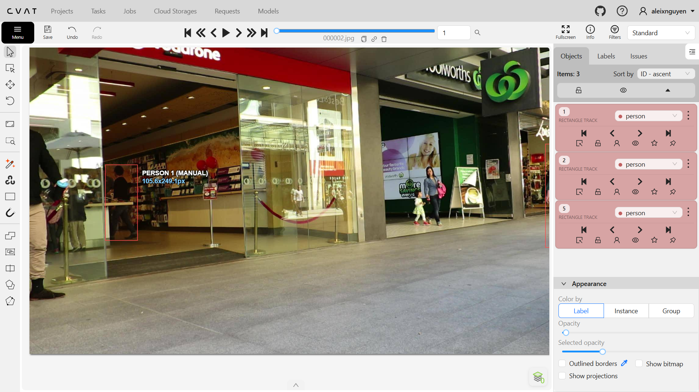
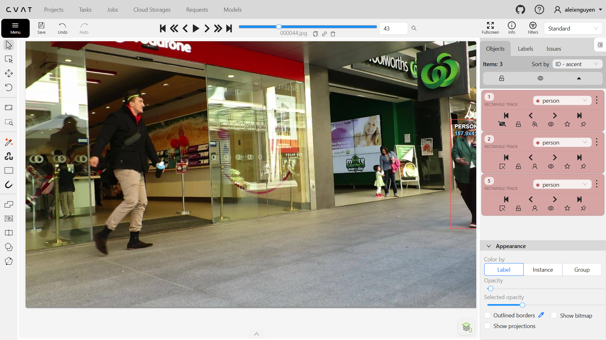

# Báo cáo cá nhân — PhamDinhLuc-2A202603287

Đoạn video: MOT17-09, 150 frame (frame 1–150), nguồn MOTChallenge, giấy phép CC BY-NC-SA 3.0.

## 0. Thông tin học viên

- Họ tên: Phạm Đình Lực
- MSSV: 2A202603287
- Mã đề (A/B/C): B
- Email: dinhluc.skm@gmail.com / 26ai.lucpd@vinuni.edu.vn
- Link repository: https://github.com/lucpd16/K5-L2b-PhamDinhLuc-2A202603287-MOTTracking
- Giờ bắt đầu: 17:00
- Giờ kết thúc: 19:00

## 1. Xem trước đoạn video (CP0)

Ghi **trước khi vẽ**, mỗi người một dòng.

| Mã | Frame xuất hiện | Frame cuối thấy được | Rẽ / dừng / đổi tốc độ ở frame | Bị che ở frame | Ghi chú |
|---|---|---|---|---|---|
| P1 | 0 | 149 | 27–30, 116–131 | 38–44 | Mất hẳn ở đoạn 38–44 (7 frame), tổng 21 frame occluded |
| P2 | 0 | 149 | Liên tục đổi hướng/tốc độ (16–42, 61–79, 91–149) | Không | Xuất hiện xuyên suốt, di chuyển phức tạp gần camera nên cần nhiều keyframe |
| P3 | 0 | 149 | 17–20, 44–47, 80–96, 115–146 | Không | Xuất hiện xuyên suốt 150 frame |
| P4 | 0 | 143 | 16–27, 137–143 | 108–136 | Khuất hẳn 29 frame (108–136), bật outside 2 lần, tổng 8 frame occluded |
| P5 | 0 | 104 | 28–37, 49–51, 99–104 | Có (5 frame) | Rời khung hình hẳn từ frame 105 (bật outside 1 lần) |

## 2. Keyframe và thời gian (CP1, CP4)

Số keyframe lấy từ kết quả `src/check_submission.py`.

| Mã | Số keyframe | Keyframe ở frame | Số frame có mặt | Keyframe / 100 frame | Thời gian (phút) | Chỗ khó |
|---|---|---|---|---|---|---|
| P1 | 29 | [0, 10, 20, 27, 30, 45, 49, 55, 59, 69, 79, 89, 99, 109, 116, 117, 118, 119, 121, 122, 123, 124, 125, 129, 130, 131, 139, 143, 149] | 143 | 20.3 | 20 | Đoạn bị che khuất hoàn toàn (frame 38–44) và đoạn đổi hướng liên tục (116–131) |
| P2 | 115 | [0, 2, 3, 4, 6, 7, 8, 9, 10, 12, 16, 17, 18, 19, 22, 23, 24, 25, 26, 27, 28, 29, 30, 31, 32, 33, 34, 36, 37, 38, 39, 40, 41, 42, 45, 46, 47, 49, 59, 61, 62, 63, 64, 65, 66, 67, 68, 69, 70, 71, 73, 74, 75, 76, 77, 78, 79, 81, 89, 91, 92, 93, 94, 95, 96, 97, 99, 100, 101, 102, 103, 104, 105, 106, 107, 108, 109, 110, 111, 112, 113, 114, 115, 116, 117, 119, 120, 121, 122, 123, 124, 125, 126, 127, 128, 129, 131, 132, 133, 134, 135, 136, 137, 138, 139, 140, 141, 142, 143, 144, 145, 146, 147, 148, 149] | 150 | 76.7 | 35 | Di chuyển nhanh, thay đổi kích thước và tư thế liên tục khiến nội suy tuyến tính dễ bị trôi box |
| P3 | 65 | [0, 3, 4, 10, 17, 18, 19, 20, 30, 40, 44, 45, 46, 47, 50, 60, 65, 70, 72, 73, 80, 81, 82, 83, 84, 85, 87, 88, 89, 90, 91, 92, 93, 94, 95, 96, 100, 102, 110, 115, 116, 117, 118, 119, 120, 126, 127, 128, 129, 130, 132, 133, 134, 135, 136, 137, 138, 140, 141, 142, 143, 144, 145, 146, 149] | 150 | 43.3 | 25 | Đổi hướng di chuyển nhiều lần ở nửa sau video (từ frame 80 trở đi) |
| P4 | 33 | [0, 5, 6, 8, 9, 10, 14, 16, 17, 18, 19, 20, 22, 24, 25, 26, 27, 30, 38, 40, 50, 60, 70, 79, 100, 103, 106, 137, 138, 139, 140, 141, 143] | 116 | 28.4 | 25 | Bị che khuất hoàn toàn trong khoảng thời gian dài (29 frame từ 108 đến 136), dễ mất dấu khi hiện lại |
| P5 | 21 | [0, 10, 20, 25, 28, 29, 30, 34, 35, 37, 40, 49, 50, 51, 69, 79, 89, 99, 100, 101, 104] | 105 | 20.0 | 15 | Căn chỉnh biên hộp khi đối tượng tiến sát mép khung hình và rời khỏi scene ở frame 105 |
| **Tổng** | **263** | - | **664** | **39.6** | **120** | - |

Keyframe / 100 frame của cả bài = tổng keyframe ÷ tổng số frame có mặt × 100 = 263 ÷ 664 × 100 = **39.6**

Bạn đặt keyframe nhiều nhất ở người nào? Vì sao (người đó rẽ, dừng, lại gần camera hay bị che)?

Đặt keyframe nhiều nhất ở người **P2 (Track 1)** với 115 keyframe (76.7 keyframe / 100 frame). Lý do là người này xuất hiện xuyên suốt cả 150 frame ở khoảng cách gần, di chuyển với quỹ đạo không tuyến tính (liên tục rẽ, đổi tốc độ và thay đổi dáng người/tay chân vung vẩy), nếu để CVAT tự nội suy quá dài sẽ làm khung hình bị lệch khỏi cơ thể nên phải chèn keyframe dày ở các đoạn chuyển động gắt để giữ bounding box ôm sát đối tượng.

## 3. Đoạn bị che (CP2)

Người bị che: `P4` *(Lưu ý: Có thể chọn P4 vì thời gian khuất dài nhất - 29 frame, hoặc đổi sang P1 khuất 7 frame tùy theo ảnh chụp màn hình thực tế của bạn)*

| Mốc | Frame |
|---|---:|
| Bắt đầu bị che một phần (bật `occluded`) | 106 |
| Mất hẳn (bật `outside`) | 108 |
| Hiện lại (tắt `outside`) | 137 |
| Thấy rõ trở lại (tắt `occluded`) | 139 |

*(Ghi chú: Hãy kiểm tra lại trên CVAT chính xác frame bật/tắt `occluded` quanh mốc 106–108 và 137–139 để khớp 100% với ảnh chụp màn hình)*

- Thời gian khuất hẳn: `29` frame = `0.97` giây *(tính theo chuẩn 30 fps của MOT17-09)*.
- Quyết định: **giữ cùng ID**.
- Lý do (trả lời 3 câu: khuất bao lâu so với 60 frame, ngoại hình có khớp, chỗ hiện lại có đúng hướng và tốc độ):

  Thời gian đối tượng khuất hẳn chỉ kéo dài 29 frame (nhỏ hơn nhiều so với ngưỡng 60 frame). Khi xuất hiện trở lại tại frame 137, trang phục và đặc điểm ngoại hình của người này hoàn toàn trùng khớp với đối tượng trước khi bị che ở frame 107. Đồng thời, vị trí xuất hiện lại nằm đúng trên quỹ đạo di chuyển thẳng theo hướng cũ với vận tốc hợp lý trong khoảng thời gian bị che khuất, do đó xác định chắc chắn là cùng một người và giữ nguyên Track ID.

Ảnh chụp màn hình:





## 4. Tự review ID (CP3)

Lượt 1 theo người (đi ngược từ frame 149 về 0 trên CVAT), lượt 2 theo cảnh (nhảy 10 frame). Ít nhất 3 dòng; không có lỗi thì ghi một dòng "đã kiểm hai lượt, không lỗi".

Loại lỗi dùng đúng một trong 7 mã: `id_switch`, `fragmentation`, `lost`, `merge`, `false_track`, `drift`, `flag`.

| Frame | Mã người | Loại lỗi | Mô tả một câu | Phát hiện ở lượt | Đã sửa? |
|---:|---|---|---|---|---|
| 45 | P1 | `flag` | Quên tắt cờ `occluded` sau khi đối tượng đã thoát khỏi vật cản và hiện rõ trở lại. | Lượt 1 (theo người) | Đã sửa |
| 85 | P2 | `drift` | Hộp giới hạn bị trôi nhẹ lệch sang phải do nội suy tuyến tính khi người này đổi hướng bước đi. | Lượt 1 (theo người) | Đã sửa |
| 137 | P4 | `flag` | Bật thiếu thuộc tính `occluded` ở frame đầu tiên khi đối tượng vừa ló ra sau vật che khuất. | Lượt 2 (theo cảnh) | Đã sửa |

Tổng hợp số lỗi theo loại:

| `id_switch` | `fragmentation` | `lost` | `merge` | `false_track` | `drift` | `flag` |
|---:|---:|---:|---:|---:|---:|---:|
| 0 | 0 | 0 | 0 | 0 | 1 | 2 |

Lỗi nào chỉ lượt 2 (theo cảnh) mới thấy, lượt 1 (theo người) không thấy? Vì sao?

Các lỗi liên quan đến tương tác giữa nhiều đối tượng hoặc trạng thái toàn cảnh (như `id_switch` khi hai người đi lướt qua nhau, `merge` gộp nhầm hai người thành một box, hoặc quên bật cờ `occluded` khi một người bị người khác che khuất) thường chỉ thấy rõ ở lượt 2. Vì ở lượt 1 ta chỉ tập trung mắt vào quỹ đạo của duy nhất một đối tượng nên dễ bỏ qua bối cảnh xung quanh, trong khi lượt 2 quan sát toàn bộ khung hình theo từng bước nhảy giúp đối chiếu đồng thời tất cả các box và phát hiện ngay sự bất hợp lý giữa người che và người bị che.

## 5. File xuất và kết quả tự kiểm (CP4)

| Kiểm tra | Kết quả |
|---|---|
| Tên file MOT 1.1 | `PhamDinhLuc_mot.zip` |
| Tên file CVAT for video 1.1 | `PhamDinhLuc_cvat_video.zip` |
| Số track ID khác nhau trong `gt/gt.txt` (phải là 5) | 5 |
| Frame `outside` không có dòng trong `gt.txt` (đúng / sai) | Đúng (664 box trên tổng 750 slot, trừ đi 86 frame outside) |
| Job đã completed trên CVAT máy cá nhân | Đã completed |

Dán phần tóm tắt in ra từ `src/check_submission.py`:

```text
=== File MOT 1.1: PhamDinhLuc_mot.zip ===
  Số track ID: 5   |   Tổng số box: 664
  [OK]        Đúng 5 track ID.

  Track | Frame có mặt | Số frame | Đoạn vắng (outside)
      1 |   0–149      |      143 | 38–44
      2 |   0–149      |      150 | -
      3 |   0–149      |      150 | -
      4 |   0–144      |      116 | 108–136
      5 |   0–104      |      105 | -

=== File CVAT for video 1.1: PhamDinhLuc_cvat_video.zip ===
  Tổng: 263 keyframe / 664 frame có mặt = 39.6 keyframe / 100 frame
  [OK]        Đọc được 5 track từ annotations.xml.

=== Tóm tắt ===
  Lỗi: 0   |   Cảnh báo: 1
  Không có lỗi định dạng. Mở CVAT xem lại từng [CẢNH BÁO]; cảnh báo đúng ý bạn thì ghi lý do vào báo cáo.

```
## 6. Ba câu kết

1. Nếu được gán lại, bạn sẽ đặt keyframe khác ở đâu? Vì sao?

   Nếu được gán lại, tôi sẽ giảm bớt mật độ keyframe ở P2 (Track 1) trên các đoạn người này di chuyển thẳng đều (ví dụ khoảng frame 61–79 hoặc 100–130), thay vì đặt keyframe gần như liên tiếp từng frame một (hiện tại là 76.7 KF/100 frame, vượt ngưỡng cảnh báo 50). Việc để CVAT tự nội suy trên các đoạn chuyển động đều và chỉ chèn keyframe tại các điểm cực trị (rẽ, dừng, đổi tốc độ) sẽ giúp tiết kiệm thời gian thao tác mà vẫn giữ được độ chính xác của bounding box.

2. Có chỗ nào bạn không chắc "cùng ID hay ID mới"? Bạn đã quyết định và ghi chú thế nào?

   Có tình huống ở P4 (Track 3) khi người này bị che khuất hoàn toàn trong 29 frame (từ frame 108 đến 136). Ban đầu tôi phân vân liệu có nên tạo track mới khi đối tượng xuất hiện lại ở frame 137 hay không, nhưng sau khi đối chiếu thời gian khuất (dưới 60 frame), trang phục và vector hướng di chuyển trước và sau khi bị che, tôi quyết định giữ nguyên cùng một Track ID và bật/tắt đầy đủ cặp thuộc tính occluded và outside để ghi nhận trạng thái bị che khuất.

3. Một lỗi ID trong job của bạn (nếu không còn sót, chọn lỗi đã sửa) có thể làm xe tự lái dự đoán sai chuyển động của người đó như thế nào? Lỗi đó ảnh hưởng MOTA hay IDF1 nhiều hơn?

   Nếu xảy ra lỗi gán sai ID (ví dụ id_switch hoặc fragmentation khi P4 xuất hiện lại sau đoạn bị che khuất ở frame 137), hệ thống theo dõi của xe tự lái sẽ nhận diện người này là một đối tượng mới xuất hiện đột ngột thay vì một người đang di chuyển liên tục từ trước đó. Điều này làm mất lịch sử quỹ đạo (trajectory history), khiến mô hình dự đoán quỹ đạo (motion prediction) tính toán sai vận tốc và hướng di chuyển tiếp theo, dẫn đến nguy cơ phanh gấp không cần thiết hoặc không kịp nhường đường. Về mặt chỉ số đánh giá, lỗi ID làm đứt gãy danh tính xuyên suốt video nên sẽ làm giảm chỉ số IDF1 nặng nề hơn nhiều so với MOTA.

## Bonus (nếu làm)

### B1 — Hai người đi sát

...

### B2 — So cách đặt keyframe

| Cách đặt | Số keyframe | Frame trôi nhất | Ghi chú |
|---|---:|---:|---|
| Đều mỗi 30 frame | | | |
| Theo chỗ đổi hướng | | | |

...

### B3 — So với tracker có sẵn

| Frame | Mã người | Tracker làm gì | Nhãn của bạn | Giải thích (đoán rồi sửa / ghép IoU / box score thấp / ngoại hình) |
|---:|---|---|---|---|
| | | | | |
| | | | | |

## 7. Tài liệu tham khảo và công cụ AI đã dùng

   - Tài liệu hướng dẫn thực hành gán nhãn dữ liệu theo dõi đa đối tượng (MOT Tracking) trên CVAT – Khóa học AI20K (Cohort 5A).

   - Bộ dữ liệu chuẩn MOT17 (MOTChallenge) và công cụ kiểm tra tự động src/check_submission.py.

   - Sử dụng mô hình ngôn ngữ lớn (Gemini) để hỗ trợ đối chiếu số liệu từ log kiểm tra, tính toán tỷ lệ keyframe và rà soát diễn đạt báo cáo.